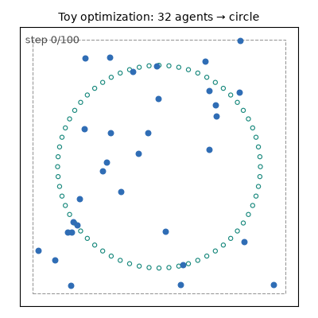

# Decentralized Swarm Shape Formation via Differentiable Simulation

CMSC 838B (Differentiable Programming) final project, UMD.

We train one small neural policy, shared by every agent, that makes a 2D swarm self-organize into a target shape using only local information. Instead of reinforcement learning or hand-tuned rules, training backpropagates a shape loss through a differentiable simulator.

**Main claim:** training through the differentiable simulator matches or beats RL on shape quality and trains much faster. The learned policy stays decentralized, scales to more agents, re-forms after agents are lost, and works on shapes it never saw in training.

## How it works

- **Simulator:** 2D point-mass agents in PyTorch; every step is differentiable.
- **Policy:** one shared MLP. Each agent sees only its nearest neighbors and nearby target points, as offsets relative to itself, and outputs an acceleration.
- **Loss:** Chamfer distance between agents and the target shape (no agent is assigned a fixed spot), plus collision and control-effort penalties.
- **Training:** roll out the swarm, compute the loss on the final state, backpropagate through every step.
- **Baselines:** Hungarian assignment + PD control, Boids / potential fields, and PPO.
- **Demo:** the trained policy runs live in the browser (ONNX + HTML Canvas).

## Setup

Requires Python 3.11 and [uv](https://docs.astral.sh/uv/).

```bash
uv sync          # create .venv and install dependencies
uv run pytest    # run the tests
```

Scripts are run from the repo root, for example:

```bash
uv run python -m scripts.toy_optimize                  # 32 agents -> circle
uv run python -m scripts.toy_optimize --shape square   # also: line
```

## Phase 1 result: gradients flow through the simulator

Before adding any neural network, we optimize the 100 × 32 accelerations directly by backpropagating the Chamfer loss through the whole rollout. The agents form the circle, which shows that the simulator, the loss and autograd work together.

<p align="center">
  
  
</p>

| Run | Start loss | Final loss | Best possible |
| --- | --- | --- | --- |
| Circle | 0.0327 | 0.00065 | 0.00058 |
| Square | 0.0312 | 0.00109 | – |

300 Adam iterations take under a second on a CPU. All 25 tests pass, including `gradcheck` on the simulator step and the loss.

Two things we learned:

- **A constant learning rate diverges.** Adam moves every parameter by about the learning rate however small its gradient is. Near the optimum the loss climbs from 0.00062 back to 0.027, so we decay the learning rate with a cosine schedule.
- **The best loss is not zero.** With 64 target points and 32 agents, each agent's best spot is a quarter of the way between two target points, which gives a minimum of (3/8)s², where s is the spacing between target points.

The derivations are in [docs/phases_explained.txt](docs/phases_explained.txt), and the architecture diagrams are in [docs/architecture/](docs/architecture/).

## Repo layout

| Path | Contents |
| --- | --- |
| `swarm/` | Core package: simulator, shapes, losses, policy, training |
| `swarm/baselines/` | Hungarian + PD, potential field, PPO |
| `configs/` | YAML run settings |
| `scripts/` | Command-line entry points |
| `tests/` | pytest tests |
| `demo/` | Browser demo |
| `results/` | Figures and GIFs for the reports |
| `report/` | Progress and final reports |
| `docs/` | Plans and background |

See [docs/STRUCTURE.md](docs/STRUCTURE.md) for details.

## Plan

| Phase | Dates | Focus | Status |
| --- | --- | --- | --- |
| 1 | Oct 15 – Oct 21 | Foundations, simulator, toy optimization | Done |
| 2 | Oct 22 – Nov 9 | Shared policy and training | Next |
| 3 | Nov 10 – Nov 17 | Baselines + progress report | |
| 4 | Nov 18 – Nov 24 | Experiments | |
| 5 | Nov 25 – Dec 1 | Browser demo + final write-up | |

The phases and their steps are in [docs/plan.txt](docs/plan.txt). The full project doc is [docs/Decentralized Swarm Shape Formation via Differentiable Simulation.md](docs/Decentralized%20Swarm%20Shape%20Formation%20via%20Differentiable%20Simulation.md).
