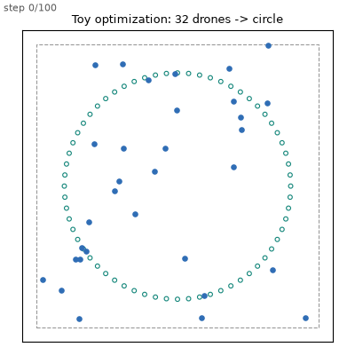
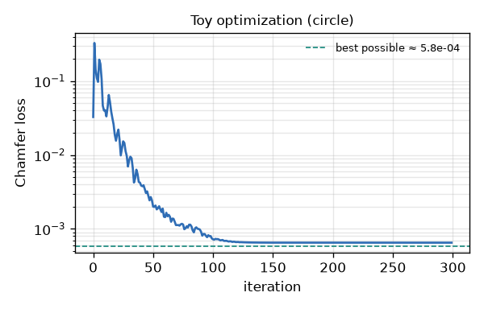
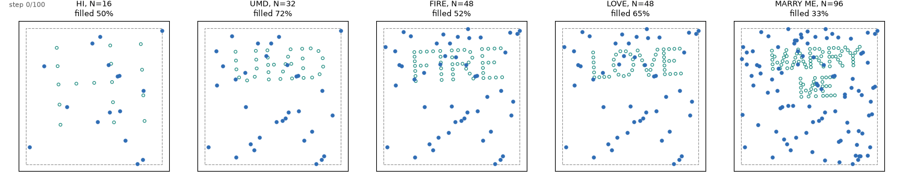

# Decentralized Swarm Shape Formation via Differentiable Simulation

CMSC 838B (Differentiable Programming) final project, UMD.

We train one small neural policy, shared by every drone, that makes a 2D swarm self-organize into a target shape using only local information. Instead of reinforcement learning or hand-tuned rules, training backpropagates a shape loss through a differentiable simulator.

**Main claim:** training through the differentiable simulator matches or beats RL on shape quality and trains much faster. The learned policy stays decentralized, scales to more drones, re-forms after drones are lost, and works on shapes it never saw in training.

## How it works

- **Simulator:** 2D point-mass drones in PyTorch; every step is differentiable.
- **Policy:** one shared MLP. Each drone sees only its nearest drones, its nearest goal points and whether those goals are taken, all relative to itself, and outputs an acceleration.
- **Loss:** Chamfer distance between drones and the target shape (no drone is assigned a fixed spot), plus collision and effort penalties.
- **Training:** roll out the swarm, score the formation, backpropagate through every step.
- **Data (v3):** one goal slot per drone (a slot at every stroke end, corner and junction, the rest evenly spaced), 8–96 drones per batch, shapes and Hershey-font strings (A–Z, 0–9) that pass a feature-size check, and a fixed benchmark scored by one-to-one matching of drones to slots.
- **Baselines (Phase 3):** Hungarian assignment + PD control, potential fields, and PPO.

## Setup

Requires Python 3.11 and [uv](https://docs.astral.sh/uv/).

```bash
uv sync          # create .venv and install dependencies (including Jupyter's kernel)
uv run pytest    # run the tests
```

Each phase is one notebook that runs end to end and can be re-run on its own. Open it in VS Code (kernel: the project's `.venv`) or Jupyter:

| Notebook | What it does | Time |
| --- | --- | --- |
| [notebooks/phase1.ipynb](notebooks/phase1.ipynb) | Simulator checks, Chamfer loss, toy optimization, learning-rate lesson, text goals with one slot per drone | ~2 min |
| [notebooks/phase2.ipynb](notebooks/phase2.ipynb) | v3 benchmark, training the shared policy, slot metrics per swarm size, GIFs | ~30 min |
| [notebooks/phase2_compare.ipynb](notebooks/phase2_compare.ipynb) | v2 and v3 policies on the same benchmark scenes | ~5 min |

The walkthroughs explain the math behind each phase: [docs/walkthrough/phase1.html](docs/walkthrough/phase1.html) and [docs/walkthrough/phase2.html](docs/walkthrough/phase2.html) (open in a browser).

## Phase 1: gradients flow through the simulator

Before adding any neural network, we optimize the 100 × 32 accelerations of one scene directly by backpropagating the Chamfer loss through the whole rollout. The drones form the circle, which shows that the simulator, the loss and autograd work together.

<p align="center">
  
  
</p>

- **A constant learning rate diverges.** Adam moves every parameter by about the learning rate however small its gradient is, so near the optimum the loss climbs back up. We decay the learning rate with a cosine schedule.
- **The best loss is not zero.** With 64 goals and 32 drones, each drone's best spot is a quarter of the way between two goals: L = (3/8)s².
- **A fixed plan only works for the scene it was made for:** from new starts it scores 0.16, worse than not moving. That motivates Phase 2.

## Phase 2: one shared policy

Every drone runs the same 6,850-weight network on what it sees: its 6 nearest drones, its 8 nearest goal slots and whether each is already taken, the scene's collision distance and its own velocity. **v3** (current) trains with one goal slot per drone and 8–96 drones per batch, including random letter/digit strings, and scores each policy by matching drones to slots one-to-one (Hungarian): *slots filled* (a drone within the collision distance of its slot), *slot error* (in drone spacings) and *steps to form*.

<p align="center">
  
</p>

All on the v3 benchmark (identical scenes, mean over N = 8–96):

| Policy | Slots filled, training shapes | Slots filled, held-out shapes | Slot error (held-out) |
| --- | --- | --- | --- |
| v2 spacing (more goals than drones) | 40% | 46% | 1.39 |
| v3 baseline | 29% | 37% | 1.30 |
| **v3 spacing** | **42%** | **50%** | **1.18** |
| Per-scene optimum (Phase 1 method) | 72% | 76% | 0.98 |

The policy works on unseen shapes and words, but it fills well under the per-scene optimum and gets worse with swarm size (55% at 8 drones, 33% at 96). The main cause is the loss: Chamfer has no one-to-one constraint, so drones pile two to a slot and leave corners and stroke ends empty. A matching-aware loss (e.g. Sinkhorn) is the proposed next fix. Details: [docs/phases_explained.txt](docs/phases_explained.txt) and [docs/walkthrough/phase2.html](docs/walkthrough/phase2.html) (v2 math).

## Repo layout

| Path | Contents |
| --- | --- |
| `swarm/` | Core package: simulator, shapes, data, losses, policy, training, plots |
| `swarm/baselines/` | Phase 3 baselines (to come) |
| `configs/default.yaml` | All settings |
| `notebooks/` | One runnable notebook per phase |
| `data/benchmark_v3/` | Fixed test scenes (one slot per drone) with their per-scene optimum; `data/benchmark/` is the v2 one |
| `results/` | Figures, GIFs and the trained policy (`results/models/`) |
| `tests/` | pytest tests |
| `docs/` | Walkthroughs, architecture diagrams, plans |
| `runs/` | Training checkpoints and logs (git-ignored) |

See [docs/STRUCTURE.md](docs/STRUCTURE.md) for details.

## Plan

| Phase | Focus | Status |
| --- | --- | --- |
| 1 | Foundations, simulator, toy optimization | Done |
| 2 | Shared policy and training | Done |
| 3 | Baselines + progress report | Next |
| 4 | Experiments | |
| 5 | Browser demo + final write-up | |

The phases and their steps are in [docs/plan.txt](docs/plan.txt). The full project doc is [docs/Decentralized Swarm Shape Formation via Differentiable Simulation.md](docs/Decentralized%20Swarm%20Shape%20Formation%20via%20Differentiable%20Simulation.md).
